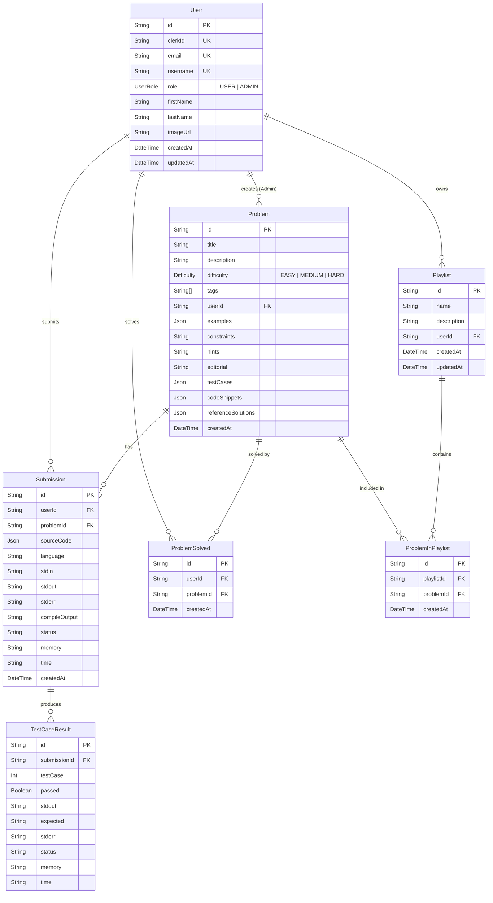

# 📘 Full-Stack LeetCode Clone — Complete Project & Architecture Guide

Welcome to the comprehensive, beginner-friendly architectural and code walkthrough for this **Full-Stack LeetCode Clone**. This guide is crafted to give you a deep, end-to-end understanding of how every component, database model, API route, server action, and external service interacts within this project.

Whether you are revising key full-stack concepts, exploring modern Next.js 15 patterns, or preparing to explain this project in a **Software Development Engineer (SDE) internship interview**, this guide covers everything you need.

---

## 📑 Table of Contents
1. [Project Overview](#1-project-overview)
2. [Tech Stack](#2-tech-stack)
3. [Project Folder Structure](#3-project-folder-structure)
4. [Project Architecture](#4-project-architecture)
5. [Complete Application Flow](#5-complete-application-flow)
6. [Important Features (Implemented vs Incomplete)](#6-important-features)
7. [Database and Prisma](#7-database-and-prisma)
8. [Important Code Explained](#8-important-code-explained)
9. [Interview Preparation (Q&A)](#9-interview-preparation)
10. [How to Explain This Project in an Interview (1–2 Minute Pitch)](#10-how-to-explain-this-project-in-an-interview)
11. [Key Concepts to Revise](#11-key-concepts-to-revise)

---

## 1. Project Overview

### What is this project?
This project is an **interactive full-stack competitive programming and coding practice platform** inspired by LeetCode. It allows developers to solve algorithmic challenges in multiple programming languages, run their code in an isolated and secure cloud sandbox, test against real-time test cases, track personal submission statistics, and bookmark problems into custom playlists.

### Why was it built?
Building a platform like LeetCode is one of the most respected full-stack engineering milestones because it involves solving complex distributed engineering challenges:
1. **Secure Remote Code Execution:** Safely running untrusted user-submitted code without putting server infrastructure at risk.
2. **Third-Party Authentication & Relational Data Sync:** Integrating OAuth/Clerk while maintaining a local PostgreSQL user store.
3. **Complex Relational Modeling:** Storing problems, test cases, multilingual boilerplate code, submissions, execution metrics, and user playlists.
4. **Role-Based Access Control (RBAC):** Providing regular developers a practice arena while granting administrators an authoring suite to write and validate new coding challenges.

### Core Capabilities at a Glance
- 🔐 **Authentication & Authorization:** Managed by Clerk with instant database user synchronization via Prisma.
- 💻 **In-Browser IDE:** Powered by Monaco Editor (the core editor behind VS Code) with multi-language syntax highlighting (JavaScript, Python, Java) and theme toggling.
- ⚡ **Sandboxed Execution Engine:** Connected to the Judge0 REST API for batch compilation and test-case grading.
- 🛡️ **Automated Admin Problem Authoring:** Admins can draft problems, but the platform tests the admin's reference solution against all input/output cases via Judge0 before permitting the problem to be saved to the database.
- 📊 **User Profile & Performance Metrics:** Visual metrics on problems solved, total submissions, overall acceptance rate, memory consumption, execution runtime, and collapsible code inspection.
- 📂 **Custom Playlists:** Ability to create problem collections (e.g., "Blind 75", "Dynamic Programming Basics") and add problems to them.

---

## 2. Tech Stack

Every technology in this project was selected for modern, production-grade web development:

| Layer | Technology | Version | Purpose in this Project |
| :--- | :--- | :--- | :--- |
| **Framework** | **Next.js (App Router)** | `15.5.2` | Core full-stack React framework providing server components, client components, API route handlers, and server actions with Turbopack bundler. |
| **Library** | **React** | `19.1.0` | Latest React version leveraging concurrent rendering, hooks, and unified server/client paradigms. |
| **Language** | **JavaScript / TypeScript definitions** | ES6+ / TS `@types` | Primary application logic written in modern JavaScript with `@types/node` and `@types/react` for editor safety. |
| **ORM** | **Prisma** | `6.15.0` | Next-generation Object-Relational Mapper (ORM) for type-safe database queries, schema definitions, and migrations. |
| **Database** | **PostgreSQL** | `15` | Relational database running inside a Docker container (`docker-compose.yml`) listening on port `5435`. |
| **Authentication** | **Clerk (`@clerk/nextjs`)** | `6.31.10` | Identity provider managing user authentication (sign-up, sign-in, OAuth sessions, user profile images). |
| **Code Execution** | **Judge0 REST API** | Cloud / Self-hosted | Remote code execution system that compiles and runs untrusted user code in isolated sandboxes and returns CPU/memory telemetry. |
| **Code Editor** | **Monaco Editor (`@monaco-editor/react`)** | `4.7.0` | VS Code-powered browser editor supporting language switching, tab sizes, formatting, and dark/light modes. |
| **Styling** | **Tailwind CSS + `@tailwindcss/postcss`** | `^4.0` | Utility-first CSS framework for responsive, modern UI styling. |
| **UI Primitives** | **Radix UI (`@radix-ui/*`) & shadcn/ui** | Various | Accessible, headless UI component primitives (Dialogs, Tables, Tabs, Selects, Dropdowns, Cards, Badges). |
| **Forms & Validation**| **React Hook Form + Zod** | `RHF 7.62`, `Zod 4.1` | Performant form state management and strict schema validation for problem and playlist creation. |
| **Icons & Feedback** | **Lucide React + Sonner** | Latest | Sleek SVG icon set and modern toast notification system. |
| **Theming** | **Next Themes** | `0.4.6` | System-aware and manual Dark Mode / Light Mode switching. |

---

## 3. Project Folder Structure

The project follows a **domain-driven, modular architecture** that cleanly separates route definitions (`app/`) from business logic and components (`modules/`).

```
leetcode/
├── app/                              # Next.js App Router (Routes & Pages)
│   ├── (auth)/                       # Route group for authentication
│   │   ├── layout.jsx                # Centered layout for auth pages
│   │   ├── sign-in/[[...sign-in]]/   # Clerk dynamic sign-in page
│   │   └── sign-up/[[...sign-up]]/   # Clerk dynamic sign-up page
│   ├── (root)/                       # Route group for main platform views
│   │   ├── layout.jsx                # Layout with global backdrop & floating Navbar
│   │   ├── page.jsx                  # Landing page (hero, features, user onboarding)
│   │   ├── problems/
│   │   │   └── page.jsx              # Problem catalog listing page
│   │   └── profile/
│   │       └── page.jsx              # User analytics and profile page
│   ├── api/                          # Backend HTTP Route Handlers
│   │   ├── create-problem/
│   │   │   └── route.js              # POST: Admin problem creation with Judge0 pre-check
│   │   └── playlists/
│   │       ├── route.js              # GET & POST: Fetch & create user playlists
│   │       └── add-problem/
│   │           └── route.js          # POST: Link problem to user playlist
│   ├── create-problem/
│   │   └── page.jsx                  # Admin UI page for authoring new challenges
│   ├── problem/[id]/
│   │   └── page.jsx                  # Dynamic coding workspace (split-screen IDE)
│   ├── globals.css                   # Global styles & Tailwind root variables
│   └── layout.js                     # Root HTML wrapper (ClerkProvider, ThemeProvider, Toaster)
│
├── modules/                          # Domain-Driven Feature Modules
│   ├── auth/
│   │   └── actions/
│   │       └── index.js              # Server actions: onBoardUser, currentUserRole, getCurrentUserData
│   ├── home/
│   │   └── components/
│   │       └── navbar.jsx            # Floating glassmorphism navigation bar
│   ├── problems/
│   │   ├── actions/
│   │   │   └── index.js              # Server actions: executeCode, getAllProblems, deleteProblem, etc.
│   │   └── components/
│   │       ├── add-to-playlist.jsx   # Modal to add problem to existing playlist
│   │       ├── create-playlist.jsx   # Modal to create new playlist
│   │       ├── create-problem-form.jsx # Rich multi-tab Monaco problem creation form
│   │       ├── problem-table.jsx     # Problem table with search, tags, difficulty filter, pagination
│   │       ├── submission-details.jsx# Metric cards (Average time, memory, success badge)
│   │       ├── submission-history.jsx# Historical list of runs for the active problem
│   │       └── test-case-table.jsx   # Granular per-test-case pass/fail breakdown
│   └── profile/
│       ├── actions/
│       │   └── index.js              # Server action: getCurrentUser with relations
│       └── components/
│           ├── playlist-section.jsx  # Grid displaying user's playlists
│           ├── profile-stats.jsx     # Metric cards: Success Rate, Submissions, Solved Count
│           ├── solved-problems.jsx   # Badges for mastered problems
│           ├── submission-history.jsx# Collapsible past submissions with full source code preview
│           └── user-info-card.jsx    # User avatar, email, join date, and role badge
│
├── lib/                              # Shared Utilities & Clients
│   ├── db.js                         # PrismaClient singleton instance
│   ├── judge0.js                     # Judge0 API integration (batch submit, polling loop)
│   └── utils.js                      # Tailwind class merger (cn helper)
│
├── components/                       # Reusable Presentation Components
│   ├── providers/
│   │   └── theme-provider.jsx        # Next-themes wrapper
│   └── ui/                           # 47 shadcn/ui components (button, card, dialog, table, etc.)
│
├── prisma/                           # Database Schema & Migrations
│   ├── migrations/                   # SQL migration history
│   └── schema.prisma                 # Prisma schema definition (7 models, 2 enums)
│
├── hooks/
│   └── use-mobile.js                 # Responsive viewport hook
├── docker-compose.yml                # Docker setup for PostgreSQL 15 (port 5435)
├── middleware.js                     # Clerk route protection middleware
├── package.json                      # Dependencies and npm scripts
└── components.json                   # shadcn/ui configuration file
```

---

## 4. Project Architecture

The architecture combines **Next.js 15 App Router**, **Server Actions**, **REST Route Handlers**, **Prisma ORM**, **PostgreSQL**, and **Judge0 Sandboxing**.

```
+---------------------------------------------------------------------------------------+
|                                    CLIENT BROWSER                                     |
|  - React 19 Client Components ("use client")                                          |
|  - Monaco Code Editor (JS, Python, Java)                                              |
|  - Real-time Toast Feedback (Sonner) & Theme Provider                                 |
+---------------------------+-----------------------------------+-----------------------+
                            |                                   |
                Server Action Invocations              HTTP REST Calls (/api/*)
                            |                                   |
+---------------------------v-----------------------------------v-----------------------+
|                                NEXT.JS BACKEND (Node.js)                              |
|                                                                                       |
|   [ Middleware (middleware.js) ] -> Clerk Auth verification                          |
|                                                                                       |
|   Server Actions (modules/*/actions):               Route Handlers (app/api/*):       |
|   - executeCode()                                   - POST /api/create-problem        |
|   - getAllProblems()                                - GET /api/playlists              |
|   - onBoardUser()                                   - POST /api/playlists             |
|   - deleteProblem()                                 - POST /api/playlists/add-problem |
|                                                                                       |
+-------------+-------------------------------------------------+-----------------------+
              |                                                 |
   Database Operations (Prisma)                       Code Execution HTTP Batch
              |                                                 |
+-------------v---------------+               +-----------------v-----------------------+
|        PRISMA ORM           |               |             JUDGE0 CLOUD / API          |
|        (lib/db.js)          |               |               (lib/judge0.js)           |
|  - Singleton PrismaClient   |               |  1. POST /submissions/batch             |
+-------------+---------------+               |  2. Polling GET /submissions/batch      |
              |                               |  3. Status 1/2 (Queued/Processing)      |
              v                               |  4. Status 3 (Accepted) / 4 (WA) / etc. |
+-----------------------------+               +-----------------------------------------+
|     POSTGRESQL DATABASE     |
|   Docker Container (5435)   |
|   - User, Problem, Submission|
|   - TestCaseResult, Playlist |
+-----------------------------+
```

### How the Parts Interact:
1. **User Request & Edge Gatekeeper (`middleware.js`):** Every incoming request is intercepted by Clerk's `clerkMiddleware`. If a route is protected (everything outside `/sign-in` and `/sign-up`), unauthenticated users are immediately redirected.
2. **Server Actions vs Route Handlers:**
   - **Server Actions (`"use server"`):** Used for RPC-style functions called directly from React components without building explicit REST routes (e.g., executing code, fetching problems, deleting problems, onboarding users).
   - **Route Handlers (`app/api/**/route.js`):** Used when standard REST endpoints with explicit JSON bodies, status codes, and HTTP methods (`GET`, `POST`) are preferred (e.g., `/api/create-problem`, `/api/playlists`).
3. **Data Access Layer (`lib/db.js`):** Prisma ORM acts as the type-safe communication bridge to PostgreSQL. A singleton pattern prevents connection exhaustion caused by Next.js hot module reloading.
4. **Third-Party Code Execution (`lib/judge0.js`):** The Next.js server acts as an orchestrator. When code needs to be executed, the Next.js server submits a batch of test cases to Judge0 via Axios, polls Judge0 until execution is complete, grades the results, saves the metrics in PostgreSQL, and streams the verdict back to the client.

---

## 5. Complete Application Flow

### Flow 1: User Authentication & Database Synchronization
```
[User] -> [Clerk Sign In / Sign Up]
             |
             v (Successful Auth)
[Redirected to Home Page '/']
             |
             v
[app/(root)/page.jsx triggers onBoardUser()]
             |
             v
[Prisma db.user.upsert()]
             |---> Checks clerkId
             |---> If exists: updates name, email, avatar
             |---> If new: creates new User record with default role USER
             v
[User Record Synced in PostgreSQL]
```
1. The user logs in via Clerk at `/sign-in`.
2. Upon redirecting to the home page (`app/(root)/page.jsx`), the server component invokes `onBoardUser()`.
3. `onBoardUser()` calls Clerk's `currentUser()` on the server to extract the user's Clerk ID, name, email, and avatar.
4. Prisma runs an **`upsert`** query on the `User` table: if the user already exists, their profile information is updated; otherwise, a new record is created with default role `USER`.

---

### Flow 2: Problem Authoring & Verification (Admin Only)
```
[Admin User] -> Navigates to /create-problem
                     |
                     v
[Fills Form: Title, Description, Test Cases, Code Snippets, Reference Solutions]
                     |
                     v
[Clicks Submit -> Sends POST request to /api/create-problem]
                     |
                     +---> 1. Check user role: db.user.role === 'ADMIN'?
                     |
                     +---> 2. For each supported language (JS, Python, Java):
                     |        - Format batch submissions for all test cases
                     |        - POST to Judge0: submitBatch(submissions)
                     |        - Poll Judge0 until complete: pollBatchResults(tokens)
                     |        - Verify ALL test cases return status.id === 3 (Accepted)
                     |
                     v
[If ANY test case fails -> Return 400 with test case error details]
[If ALL test cases pass  -> db.problem.create() -> Save to Postgres -> Return 201]
```
1. An administrator visits `/create-problem` (protected by role checking).
2. The admin defines problem specifications, test cases (input/output), starting code snippets, and **Reference Solutions** in JavaScript, Python, and Java.
3. Upon clicking submit, `POST /api/create-problem` runs.
4. **Automated Verification:** The server takes the admin's reference solutions and submits them to Judge0 against the provided test cases.
5. Only if **every test case for every language passes** (`status.id === 3`) does Prisma write the new problem to the `Problem` table. This prevents broken or unverified problems from ever reaching the platform.

---

### Flow 3: Code Execution & Grading Flow
```
[User] -> Opens Problem (/problem/[id]) -> Types solution in Monaco Editor
             |
             v
[Clicks "Run" Button]
             |
             v
[Client calls Server Action: executeCode(source_code, language_id, stdin, expected_outputs, problemId)]
             |
             v
[Server prepares Judge0 payload for all test cases]
             |
             v
[Axios POST to Judge0 /submissions/batch] -> Returns tokens [token1, token2, ...]
             |
             v
[Polling Loop in pollBatchResults() every 1000ms until status.id !== 1 (In Queue) and !== 2 (Processing)]
             |
             v
[Next.js Server Compares stdout with expected_output]
             |
             +---> allPassed = (stdout.trim() === expected.trim()) for all cases
             |
             +---> db.submission.create(): Logs code, language, status, memory, runtime
             |
             +---> If allPassed: db.problemSolved.upsert() marks problem as Solved
             |
             +---> db.testCaseResult.createMany(): Saves granular per-test-case metrics
             v
[Returns detailed submission object to client]
             |
             v
[Monaco Page displays: Pass/Fail badge, Avg Memory/Time, and TestCaseTable]
```

---

### Flow 4: Playlist Management Flow
```
[User on /problems page]
        |
        +---> [Create Playlist Modal]
        |        |
        |        v
        |     POST /api/playlists { name, description }
        |        |
        |        v
        |     db.playlist.create({ data: { name, description, userId } })
        |
        +---> [Click "Save" on Problem Row]
                 |
                 v
              GET /api/playlists (loads user's playlists into modal)
                 |
                 v
              User clicks "Add" on a specific playlist
                 |
                 v
              POST /api/playlists/add-problem { problemId, playlistId }
                 |
                 v
              db.problemInPlaylist.create() (with composite unique key)
```

---

## 6. Important Features

### 1. Monaco Code Editor Workspace
- **File:** `app/problem/[id]/page.jsx`
- Features responsive split-pane layout: problem statement, examples, and constraints on the left; Monaco code editor, test case viewer, and run button on the right.
- Language switcher dropdown automatically populates the editor with the starter boilerplate for JavaScript, Python, or Java.

### 2. Multi-Language Remote Code Execution
- **Files:** `lib/judge0.js`, `modules/problems/actions/index.js` (`executeCode`)
- Maps platform languages to Judge0 language IDs:
  - Python $\rightarrow$ `71`
  - JavaScript (Node.js) $\rightarrow$ `63`
  - Java (OpenJDK) $\rightarrow$ `62`
  - C++ $\rightarrow$ `54`
  - Go $\rightarrow$ `60`
- Uses **batch processing**: submits all test cases simultaneously in one API call and polls until all tokens have finished processing.

### 3. Problem Discovery & Multi-Filter Table
- **File:** `modules/problems/components/problem-table.jsx`
- Fast, client-side dynamic filtering:
  - **Search:** Real-time title search.
  - **Difficulty Filter:** Filter by EASY, MEDIUM, HARD, or ALL.
  - **Tags Filter:** Dynamically extracts all unique tags from available problems.
  - **Solved Indicator:** Checks if current user's ID exists in the problem's `solvedBy` array and displays a green checkbox.
  - **Pagination:** Clean 5-items-per-page client-side pagination.

### 4. User Profile & Learning Analytics
- **File:** `app/(root)/profile/page.jsx`
- Computes real-time statistics:
  - Acceptance/Success Rate: $\frac{\text{Accepted Submissions}}{\text{Total Submissions}} \times 100$
  - Total problems solved count
  - Total playlists created
  - History of previous submissions with collapsible source code viewer, execution time, and memory usage.

---

### ⚠️ Clearly Distinguishing: Implemented vs. Incomplete / Gotchas in the Codebase

To truly understand this codebase like a senior engineer, you must know what is fully functional and where current development items exist:

| Feature / Location | Status | Details & Observation in Code |
| :--- | :--- | :--- |
| **"Run" Button in Problem View** | ✅ **Fully Implemented** | Calls `executeCode()` server action, communicates with Judge0, logs `Submission` and `TestCaseResult` in Postgres, and marks `ProblemSolved`. |
| **"Submit" Button in Problem View** | ⚠️ **Incomplete / Placeholder** | In `app/problem/[id]/page.jsx` (lines 112–114): `handleSubmit` only triggers a toast: `toast.success("TODO: Coming Soon🔥")`. Full grading currently occurs under the "Run" button. |
| **Problem Edit Button in Table** | ⚠️ **Disabled in UI** | In `problem-table.jsx` (line 308): The pencil edit icon has the `disabled` HTML attribute set. |
| **Problem Playlist Server Actions vs API Routes** | ⚠️ **Code Divergence** | In `modules/problems/actions/index.js`: `createPlaylist` and `addProblemToPlaylist` have outdated field names (`title` instead of `name`, `playlistProblem` instead of `problemInPlaylist`). **However**, the UI components (`create-playlist.jsx` & `add-to-playlist.jsx`) correctly use the working Next.js Route Handlers (`/api/playlists` and `/api/playlists/add-problem`). |
| **`app/api/create-problem/route.js` import** | ⚠️ **Minor Import Mismatch** | Line 2 imports `getCurrentUser` from `@/modules/auth/actions`, where the action is named `getCurrentUserData` (while `getCurrentUser` is in `@/modules/profile/actions`). |

---

## 7. Database and Prisma

The database uses PostgreSQL managed through Prisma (`prisma/schema.prisma`).

### Entity Relationship Diagram (ERD)



### Explaining the Models & Schema Design
1. **`User` Model:**
   - Stores user profile data. `clerkId` is `@unique`, forming the bridge between Clerk session tokens and internal database rows.
   - `role` uses the `UserRole` enum (`USER`, `ADMIN`) with `@default(USER)`.
2. **`Problem` Model:**
   - Contains problem metadata. Multilingual starter code (`codeSnippets`), sample cases (`examples`), test cases (`testCases`), and verified solutions (`referenceSolutions`) are stored efficiently as **`Json`** fields. This eliminates the need for separate tables for each programming language.
3. **`Submission` & `TestCaseResult` Models:**
   - 1-to-many relationship: One `Submission` contains multiple `TestCaseResult` records (one for each test case executed in Judge0).
   - Stores time, memory, stdout, stderr, compile output, and verdict.
4. **`ProblemSolved` Model:**
   - Pivot table establishing a many-to-many relationship between users and solved problems.
   - Contains `@@unique([userId, problemId])` ensuring a problem cannot be marked as solved more than once for a single user.
5. **`Playlist` & `ProblemInPlaylist` Models:**
   - A user can create multiple playlists (`@@unique([name, userId])` ensures unique playlist names per user).
   - `ProblemInPlaylist` is a join table linking playlists to problems with `@@unique([playlistId, problemId])` to prevent duplicate problem entries in a playlist.

### Docker Setup
Defined in `docker-compose.yml`:
```yaml
services:
  postgres:
    image: postgres:15
    container_name: leetcode_db_new
    environment:
      POSTGRES_DB: leetcode
      POSTGRES_USER: postgresS
      POSTGRES_PASSWORD: postgres123
    ports:
      - "5435:5432"   # Host port 5435 mapped to container 5432
    volumes:
      - leetcode_db_data:/var/lib/postgresql/data
```
The database runs locally inside Docker, mapped to host port **5435** to prevent port conflicts with any existing standard PostgreSQL installations on port 5432.

---

## 8. Important Code Explained

### 1. Prisma Client Singleton Pattern
**File:** [lib/db.js](file:///d:/AI-Ml(Prime)/30)/30%20KE%20BAD/next.js(course)/Nextjs-Course-2026-master/Fullstack-Projects/leetcode/lib/db.js)
```javascript
import { PrismaClient } from "@prisma/client";

const globalForPrisma = globalThis;

export const db = globalForPrisma.prisma || new PrismaClient();

if (process.env.NODE_ENV !== 'production') globalForPrisma.prisma = db;
```
**Why this matters:**
In Next.js development mode, Hot Module Replacement (HMR) re-executes server files whenever code is edited. If you simply instantiate `new PrismaClient()`, every code save will create a new database connection pool until PostgreSQL runs out of connection slots (`too many clients already`). By saving the instance onto `globalThis`, the connection is preserved across reloads.

---

### 2. Judge0 Batch Submission & Polling Loop
**File:** [lib/judge0.js](file:///d:/AI-Ml(Prime)/30)/30%20KE%20BAD/next.js(course)/Nextjs-Course-2026-master/Fullstack-Projects/leetcode/lib/judge0.js)
```javascript
export async function pollBatchResults(tokens) {
  while (true) {
    const { data } = await axios.get(
      `${process.env.JUDGE0_API_URL}/submissions/batch`,
      {
        params: {
          tokens: tokens.join(","),
          base64_encoded: false,
        },
      }
    );

    const results = data.submissions;
    // Status 1 = In Queue, Status 2 = Processing
    const isAllDone = results.every(
      (r) => r.status.id !== 1 && r.status.id !== 2
    );
    if (isAllDone) return results;

    await sleep(1000); // Wait 1 second before next poll
  }
}
```
**Why this matters:**
Judge0 processes code asynchronously. Instead of holding open a single HTTP connection that could time out, we submit a batch, receive back an array of cryptographic tokens, and poll the `/submissions/batch` endpoint every second until every single submission has exited state `1` (In Queue) and `2` (Processing).

---

### 3. Server Action for Code Execution & Evaluation
**File:** [modules/problems/actions/index.js](file:///d:/AI-Ml(Prime)/30)/30%20KE%20BAD/next.js(course)/Nextjs-Course-2026-master/Fullstack-Projects/leetcode/modules/problems/actions/index.js)
```javascript
export const executeCode = async (source_code, language_id, stdin, expected_outputs, id) => {
    const user = await currentUser();
    const dbUser = await db.user.findUnique({ where: { clerkId: user.id } });

    // 1. Build batch payloads
    const submissions = stdin.map((input) => ({
      source_code,
      language_id,
      stdin: input,
      base64_encoded: false,
      wait: false,
    }));

    // 2. Submit batch & poll results
    const submitResponse = await submitBatch(submissions);
    const tokens = submitResponse.map((res) => res.token);
    const results = await pollBatchResults(tokens);

    // 3. Grade test cases
    let allPassed = true;
    const detailedResults = results.map((result, i) => {
      const stdout = result.stdout?.trim() || null;
      const expected_output = expected_outputs[i]?.trim();
      const passed = stdout === expected_output;
      if (!passed) allPassed = false;
      return { testCase: i + 1, passed, stdout, expected: expected_output, ... };
    });

    // 4. Save to Database
    const submission = await db.submission.create({
      data: {
        userId: dbUser.id,
        problemId: id,
        sourceCode: source_code,
        language: getLanguageName(language_id),
        status: allPassed ? 'Accepted' : 'Wrong Answer',
        ...
      },
    });

    // 5. Mark as solved if all passed
    if (allPassed) {
      await db.problemSolved.upsert({
        where: { userId_problemId: { userId: dbUser.id, problemId: id } },
        update: {},
        create: { userId: dbUser.id, problemId: id },
      });
    }

    return { success: true, submission: submissionWithTestCases };
};
```
**Why this matters:**
This is the core business logic of the entire application. It bridges the client editor, the remote sandbox (Judge0), and the relational database in a secure server-side transaction.

---

### 4. Admin Verification Before Creation
**File:** [app/api/create-problem/route.js](file:///d:/AI-Ml(Prime)/30)/30%20KE%20BAD/next.js(course)/Nextjs-Course-2026-master/Fullstack-Projects/leetcode/app/api/create-problem/route.js)
```javascript
for (const [language, solutionCode] of Object.entries(referenceSolutions)) {
  const languageId = getJudge0LanguageId(language);
  const submissions = testCases.map(({ input, output }) => ({
    source_code: solutionCode,
    language_id: languageId,
    stdin: input,
    expected_output: output,
  }));

  const submissionResults = await submitBatch(submissions);
  const results = await pollBatchResults(submissionResults.map(r => r.token));

  // Must have status.id === 3 (Accepted)
  for (let i = 0; i < results.length; i++) {
    if (results[i].status.id !== 3) {
      return NextResponse.json({ error: `Validation failed for ${language}` }, { status: 400 });
    }
  }
}
// Save problem to DB only after validation passes
await db.problem.create({ ... });
```
**Why this matters:**
Prevents human error when authoring questions. If an admin writes an incorrect reference solution or supplies invalid expected test case outputs, Judge0 catches it immediately during creation and rejects the HTTP request before any database entry is made.

---

## 9. Interview Preparation

Here are key full-stack questions specifically tailored to this project, along with high-impact answers suitable for an SDE internship interview:

### Q1: Why did you choose Next.js 15 App Router instead of a separate React frontend and Express backend?
> **Answer:**
> Next.js 15 provides a unified full-stack architecture that reduces network round-trips and eliminates boilerplate. With React Server Components (RSC), initial page data (such as problem lists or user profiles) can be rendered directly on the server close to our database without client-side waterfall requests. Furthermore, Server Actions allow secure direct database and API interactions without having to build, document, and maintain duplicate REST route controllers for every user action.

### Q2: How does the application execute untrusted user code safely? Why not just use Node.js `child_process.exec()` or `eval()`?
> **Answer:**
> Running untrusted user code using `eval()` or `child_process.exec()` on our primary application server is a major security vulnerability. An attacker could execute malicious commands (e.g., `rm -rf`, reading environment variables, or initiating DDoS attacks) or monopolize server memory and CPU with an infinite loop. We integrate with **Judge0**, an isolated remote execution sandbox that executes code inside secure, sandboxed Linux containers with strict CPU time limits, memory caps, and restricted system call permissions.

### Q3: How does authentication sync between Clerk and your PostgreSQL database?
> **Answer:**
> Clerk handles user sessions, OAuth providers, and security tokens. To maintain relational data (submissions, solved problems, playlists), we synchronize the user with our PostgreSQL database using Prisma's `upsert` query via the `onBoardUser()` action. The user's unique `clerkId` is mapped to a PostgreSQL `User` record. This guarantees idempotency: regardless of how many times a user accesses the platform, their record is safely created or updated without primary key conflicts.

### Q4: What is the Prisma Client singleton pattern and why is it necessary?
> **Answer:**
> In development mode, Next.js utilizes Hot Module Replacement (HMR). Every time a developer saves a file, the module re-evaluates. If `new PrismaClient()` is created directly in a file, every reload initiates a new database connection pool. Within a few saves, PostgreSQL reaches its maximum connection limit. Storing the Prisma instance on Node's `globalThis` ensures that only one single connection pool persists across hot reloads.

### Q5: How does the code execution polling mechanism work? What are its trade-offs?
> **Answer:**
> Because compiling and running code takes variable time, we submit code to Judge0 asynchronously via batch POST, receiving submission tokens. We then poll `/submissions/batch` every second until all statuses transition out of `In Queue` or `Processing`. 
> - *Trade-off:* While HTTP polling is simple to implement and stateless, it creates repeated HTTP requests. In high-traffic production, an architectural upgrade would be using **Judge0 Webhooks** or an asynchronous message queue (e.g., BullMQ + Redis) with WebSockets/Server-Sent Events (SSE) to push completion events to the client.

### Q6: How does the platform enforce Role-Based Access Control (RBAC)?
> **Answer:**
> In our PostgreSQL schema, users have a `UserRole` enum (`USER` or `ADMIN`). In the UI, administrative controls (like the "Create Problem" button or "Delete Problem" icon) only render if `userRole === 'ADMIN'`. More importantly, access control is enforced on the server: inside `app/api/create-problem/route.js` and `deleteProblem()`, the server verifies the user's role in the database before proceeding, preventing unauthorized API calls or malicious bypasses.

### Q7: How are many-to-many relationships modeled in this schema?
> **Answer:**
> We use explicit join tables with composite unique constraints:
> 1. `ProblemSolved`: Links `User` and `Problem` with `@@unique([userId, problemId])`, preventing duplicate records when a user runs code multiple times.
> 2. `ProblemInPlaylist`: Links `Playlist` and `Problem` with `@@unique([playlistId, problemId])`, guaranteeing that a problem cannot be added twice to the same playlist.

### Q8: How would you scale this platform to support 50,000 concurrent submissions?
> **Answer:**
> 1. **Message Queuing:** Introduce Redis and BullMQ/Kafka between the Next.js server and execution workers to buffer spikes in submission volume.
> 2. **Worker Scaling:** Deploy auto-scaling Judge0 worker nodes across container clusters (AWS ECS or Kubernetes).
> 3. **Caching:** Cache problem descriptions, test cases, and tags using Redis or Next.js `unstable_cache` so the database isn't hit for static reads.
> 4. **Push Notifications:** Replace HTTP polling with WebSockets or Server-Sent Events (SSE) to stream execution status back to the browser.

---

## 10. How to Explain This Project in an Interview

*Use this concise, structured 90-second explanation when an interviewer asks: **"Tell me about a full-stack project you've built."***

> "I built a full-stack competitive programming platform inspired by LeetCode, developed with Next.js 15 App Router, React 19, PostgreSQL, Prisma ORM, and Tailwind CSS.
>
> The core challenge of building a platform like this is securely executing untrusted user code across multiple languages. Rather than running code directly on the application server—which presents major security and resource risks—I integrated the Judge0 remote execution engine. When a user runs their code in the Monaco Editor, our server submits a batch job to Judge0, polls for output, evaluates memory and execution runtime against test cases, and stores the submission telemetry in PostgreSQL.
>
> On the data layer, I designed a relational schema supporting Role-Based Access Control, user playlists, and solved problem tracking with composite unique keys. For problem authoring, I implemented an automated verification pipeline: before an admin can create a new problem, the backend automatically runs the admin's reference solutions in JavaScript, Python, and Java against all test cases in Judge0 to guarantee correctness before persisting to the database.
>
> For authentication, I integrated Clerk and synchronized it with PostgreSQL using an idempotent Prisma upsert pattern. Overall, this project helped me master secure API design, asynchronous execution polling, relational database modeling, and modern Next.js 15 server-side patterns."

---

## 11. Key Concepts to Revise

Before your interview, make sure you are comfortable with each of these core concepts implemented in the codebase:

### 1. Next.js 15 & React 19
- [x] **Server Components vs Client Components:** Understanding why the problem table is `"use client"` (needs `useState` for search/filtering) while the problems page is a Server Component (fetches initial data directly).
- [x] **Server Actions (`"use server"`):** How functions like `executeCode()` and `getAllProblems()` run strictly on the Node.js runtime and can be imported directly into client components.
- [x] **Route Handlers (`route.js`):** Handling standard `GET` and `POST` HTTP requests with `NextResponse.json()`.
- [x] **Dynamic Routing:** Using `app/problem/[id]/page.jsx` with asynchronous route parameter unwrapping (`await params`).

### 2. Database & Prisma ORM
- [x] **Prisma Client Singleton:** Why storing the instance on `globalThis` avoids connection exhaustion during development.
- [x] **Schema Modeling:** Defining enums (`UserRole`, `Difficulty`), JSON columns for multilingual snippets, and foreign key relations (`@relation` with `onDelete: Cascade`).
- [x] **Composite Unique Keys:** `@@unique([userId, problemId])` and `@@unique([playlistId, problemId])`.
- [x] **Database Indexing:** Using `@@index([role])`, `@@index([difficulty])`, and `@@index([status])` for query optimization.

### 3. Authentication & Security
- [x] **Edge Middleware (`middleware.js`):** Route matching regex and `auth.protect()` for route protection.
- [x] **Idempotent User Upsert:** Handling first-time OAuth logins and recurring visits cleanly with Prisma `upsert`.
- [x] **Role-Based Authorization:** Validating user roles on the backend before executing privileged actions (e.g., deleting or creating problems).

### 4. Code Execution & System Integration
- [x] **Sandboxed Code Execution:** Why isolated execution (Judge0 / Docker) is mandatory for untrusted user inputs.
- [x] **Batch Execution & HTTP Polling:** Submitting multiple test cases in a single payload and polling until completion.
- [x] **Form State Management & Validation:** Using `react-hook-form` with `zodResolver` to validate complex dynamic forms (like multi-test case problem creation).
